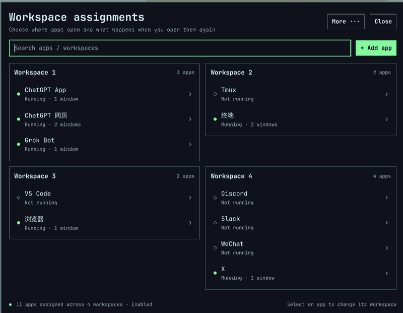

# Omarchy Workspaces

**Put apps where they belong. Reopen them without hunting for windows.**

[**English**](README.md) | [简体中文](README.zh-CN.md)

Omarchy Workspaces is a native [Omarchy](https://github.com/omacom/omarchy) plugin for managing where apps open in Hyprland. Assign a preferred workspace to each app, bring an existing window into focus instead of launching another one, and keep your everyday desktop organized without editing window rules by hand.

> **Release status:** `1.3.0-rc.1` (public beta / release candidate). Primary target: Omarchy 4.0.4 with Hyprland's Lua configuration. The owner has completed real-desktop acceptance of the redesigned panel (2026-10-13). The project has not yet tagged a stable release.
>
> **Updated UI:** The workspace-grouped panel is included in `main` following [PR #1](https://github.com/CoderLambert/omarchy-workspace-plugin/pull/1). No special branch checkout is required.

## Screenshot



*Real Omarchy desktop screenshot, shared with the author's permission. App assignments are customizable.*

## Why use it?

| Feature | What it does |
| --- | --- |
| **Predictable workspaces** | Assign apps to workspaces `1–999`; newly opened managed windows follow their assignments. |
| **Launch or focus** | Reusing a managed launcher, menu item or opted-in shortcut focuses a matching window when one exists, rather than needlessly starting another instance. |
| **Your choice of window behavior** | Focus a window **where it is**, or move it back to its preferred workspace before focusing. |
| **Visible app launches** | Native shortcuts that create a managed window switch to its assigned workspace, so launches do not disappear off-screen. Managed windows can also accept activation requests when already open. |
| **Scratchpad-aware** | Apps launched while the `Super+S` scratchpad is visible can remain there; ordinary launches follow their configured workspaces. |
| **Native interface** | A configurable panel follows Omarchy's theme, typography and scaling, with Chinese and English UI. |
| **Safe configuration** | Preview conflicting shortcuts, preserve existing app assignments, detect externally modified managed files, and restore or disable rules explicitly. |

No additional long-running background service is installed: the Python backend is invoked when needed. The plugin does not automatically take over your apps or rearrange windows during installation.

## Requirements

- **Omarchy 4.0.4** (primary tested target), Omarchy Shell / Quickshell, and its native plugin commands.
- **Python 3.11+**, Hyprland `hyprctl`, `gtk-launch` and `omarchy-launch-tui`.
- `tmux` only if you want the optional tmux integration.

Install in a terminal **inside your normal Omarchy desktop session**. Do not run the installer with `sudo`.

## Install

### Recommended: Omarchy's plugin manager

```bash
omarchy plugin add https://github.com/CoderLambert/omarchy-workspace-plugin.git --enable
bash ~/.config/omarchy/plugins/lambert.workspaces/install.sh --backend-only
~/.local/bin/omarchy-workspaces gui
```

The first command installs and enables the native panel. The second installs the Python backend and the system-menu entry: **Omarchy's plugin manager does not run the backend installer automatically**. The third opens the configuration interface.

Already installed? Skip `omarchy plugin add` and follow [Update](#update) instead.

### Alternative: clone or download the source

```bash
git clone https://github.com/CoderLambert/omarchy-workspace-plugin.git
cd omarchy-workspace-plugin
bash install.sh
~/.local/bin/omarchy-workspaces gui
```

You can also use **Code → Download ZIP** on GitHub, extract it, and run `bash install.sh` in the directory containing `manifest.json`. This is a user-level installation; the project's own dotfiles are **not** required.

### Updated workspace interface

The current `main` includes the redesigned panel: apps grouped by workspace, focused per-app editing, and separate **Save** versus **Save and move** actions. See the [design and verification notes](docs/UI-SIMPLIFICATION.md). If you already have the plugin installed, follow [Update](#update) to synchronize the panel and backend.

## First-time setup

Opening the panel does not automatically manage applications. You can configure one app at a time, or choose a suggested arrangement.

### Suggested arrangement

| Workspace | Example apps |
| --- | --- |
| **1 · AI** | ChatGPT App, ChatGPT web app, Grok Bot |
| **2 · Development** | Terminal, tmux, VS Code |
| **3 · Browsing** | Main browser |
| **4 · Communication** | WeChat, Slack, X, Discord |

These are **editable examples**, not mandatory workspace names or fixed mappings. Open the apps you want to identify first, then choose the panel's recommended setup action, or run:

```bash
omarchy-workspaces setup
```

**Important:** `setup` discovers supported apps, applies managed launch rules and can **arrange already registered windows**. Review the result before using it on an active desktop. By default it **does not override Omarchy's keyboard shortcuts**. Ambiguous app identities are skipped instead of guessed.

### Configure a single app

Open an app normally first, then use **Add app** in the panel (currently a terminal wizard) or run:

```bash
omarchy-workspaces add Obsidian --workspace 2
omarchy-workspaces list
```

Select an app in the panel and choose its preferred workspace and reopening behavior. In the redesigned UI, **Save** changes the setting but **does not move existing windows**; choose **Save and move** explicitly if you want to arrange that app immediately.

### Choose how an existing window is reused

Suppose Slack is assigned to workspace **4**, but you manually move its window to **5**:

| Mode | When you launch Slack again through a managed entry |
| --- | --- |
| `focus` (default) | Switch to the existing window on **5**; leave it where it is. |
| `move` | Move the existing window back to **4**, then focus it. |

```bash
omarchy-workspaces set slack --workspace 4
omarchy-workspaces set slack --existing-window focus
omarchy-workspaces arrange --dry-run
omarchy-workspaces arrange --app slack
```

Use the actual app ID from `omarchy-workspaces list`; `slack` is only an example. `arrange --dry-run` previews changes. Arrange actions preserve scratchpad and other special workspaces unless you explicitly opt in to including them.

### Optional shortcuts and scratchpad

```bash
omarchy-workspaces setup --with-shortcuts
```

Shortcut installation is **opt-in**. If a binding conflicts, its original command and proposed replacement are shown, and that individual conflict requires explicit approval. Omarchy's default bindings remain in place otherwise.

To use the scratchpad, show it with `Super+S` and launch a managed application while it is visible. That application's window can stay in the scratchpad and be shown or hidden with Omarchy's existing binding.

## Update

For a standard Git-installed plugin, update the plugin using Omarchy's update command, **then update the backend**:

```bash
omarchy plugin update lambert.workspaces
bash ~/.config/omarchy/plugins/lambert.workspaces/install.sh --backend-only
omarchy restart shell
```

If you are testing the preview branch, a regular plugin update may change the checked-out revision: review which branch or commit you intend to run. Source/ZIP installs can be upgraded from a fresh source directory using `bash install.sh --no-setup`.

Existing app assignments in `apps.toml` are preserved. Do not delete your configuration or reinstall from scratch just to update the UI.

## Troubleshooting and recovery

```bash
omarchy-workspaces --version
omarchy-workspaces doctor           # Check configuration, managed files and rules
hyprctl configerrors                # Check Hyprland configuration
omarchy-workspaces recover          # Recover an interrupted configuration transaction
omarchy-workspaces reset            # Stop managing rules, keep the app assignments
omarchy-workspaces apply            # Reapply saved assignments
```

If `doctor` detects external changes to a managed `.desktop` file, inspect them **before** choosing `apply --adopt`. Adopting changes updates the recovery baseline; it is not a generic “ignore errors” command.

Disabling or removing only the native UI plugin does **not** undo launcher, workspace or shortcut rules. Use `reset` first if you want to stop managing those rules. `reset` does not close applications or move already-open windows back.

| Data | Default location |
| --- | --- |
| Native plugin | `~/.config/omarchy/plugins/lambert.workspaces/` |
| Application assignments | `~/.config/omarchy-workspaces/apps.toml` |
| Panel language preference | `~/.config/omarchy-workspaces/ui.ini` |
| Installed backend | `~/.local/share/omarchy-workspaces/` |
| Recovery state and logs | `~/.local/state/omarchy-workspaces/` |

## Scope and limitations

Window reuse applies to **managed launch entry points**, not every arbitrary way of starting an application. Multiple existing windows are not merged or closed. Ordinary browser tabs cannot be assigned separate Hyprland workspaces; web apps/PWAs need distinct, trustworthy window identities. Real app compatibility, multi-monitor layouts and other untested combinations may require additional verification.

## Documentation

- [Installation and removal](docs/INSTALL.md) · [Panel, CLI and configuration](docs/USAGE.md) · [Troubleshooting](docs/TROUBLESHOOTING.md) (detailed guides currently in Chinese)
- [UI redesign and testing](https://github.com/CoderLambert/omarchy-workspace-plugin/blob/codex/simplify-workspace-ui/docs/UI-SIMPLIFICATION.md) (preview branch)
- [Release checklist](docs/RELEASE-CHECKLIST.md) · [Changelog](CHANGELOG.md)

**License:** [GPL-3.0-only](LICENSE). Referenced Omarchy code retains its original license; see [third-party sources](reference/SOURCES.md).
